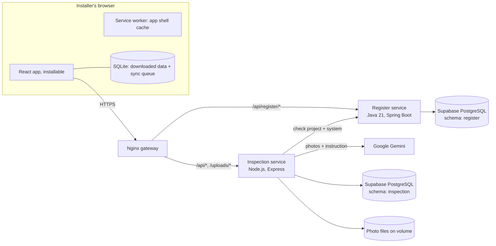

# System design

Status: target design. Nothing here is implemented yet; the
"Current state" section describes the repository as it is today.
Related documents: [01-business-logic.md](./01-business-logic.md) (rules and terms)
and [03-slice-spec.md](./03-slice-spec.md) (build order and acceptance checks).

## Current state

| Part | Today |
| --- | --- |
| Java service | Spring Boot 4.1 on Java 21, `Product` CRUD at `/api/products`, H2 in memory, no authentication. Package `com.example.crud.product` |
| Node service | `apps/inspection-api`, Express 5, inspections in `data/inspections.json`, photos in `data/uploads`, HS256 JWT valid for 8 hours, three in-code demo users |
| Web | `apps/inspection-web`, React 19 + Vite, Nginx proxies `/api/`, `/health`, `/uploads/` to the Node service. It never calls the Java service |
| Deployment | Kubernetes namespace `product-crud`; Java on NodePort 30080, web on NodePort 30173 over plain HTTP, Node service internal on 4000 |

## Target architecture

## Responsibilities

| Component | Owns | Does not do |
| --- | --- | --- |
| Register service (Java) | Projects and approved firestop systems; the snapshot used for offline download | Inspection records, photos, AI |
| Inspection service (Node) | Sign-in, inspection records, photos, AI drafts | Storing or editing projects and systems; it only keeps a copy of the system details on each record |
| Web app | Admin and installer screens, the offline copy, the sync queue | Business validation beyond form checks; the services decide |
| Nginx gateway | One origin for the browser; routing by path | Authentication; each service validates the token itself |

The browser talks to both services through the gateway. The one
service-to-service call is the inspection service asking the register service
about a system.

## Register service (Java)

**Stack additions:** PostgreSQL driver, Flyway, Spring Security resource
server. H2 stays for the `local` and `test` profiles only.

**Packages:** `com.example.crud.register` replaces `com.example.crud.product`.
The Maven artifact, image and Kubernetes names stay `product-crud` for now; see
"Open decisions".

**Tables (schema `register`)**

| Table | Columns |
| --- | --- |
| `project` | `id` uuid PK, `code` unique, `name`, `address`, `active`, `created_at`, `updated_at` |
| `firestop_system` | `id` uuid PK, `project_id` FK, `code`, `substrate`, `service_type`, `fire_rating`, `materials`, `installation_method`, `active`, `created_at`, `updated_at`; unique (`project_id`, `code`) |

**API**

| Method | Path | Role | Purpose |
| --- | --- | --- | --- |
| GET | `/api/register/projects` | any signed-in | List projects |
| POST | `/api/register/projects` | ADMIN | Create |
| GET | `/api/register/projects/{id}` | any signed-in | Read one |
| PUT | `/api/register/projects/{id}` | ADMIN | Update, including `active` |
| GET | `/api/register/projects/{id}/systems` | any signed-in | List a project's systems |
| POST | `/api/register/projects/{id}/systems` | ADMIN | Add a system |
| GET | `/api/register/projects/{id}/systems/{systemId}` | any signed-in | Read one; used by the inspection service |
| PUT | `/api/register/projects/{id}/systems/{systemId}` | ADMIN | Update, including `active` |
| GET | `/api/register/snapshot` | any signed-in | All active projects with their active systems, plus `generatedAt`; used for offline download |

There is no DELETE endpoint; a DELETE request returns 405.

**Field rules**

| Field | Rule |
| --- | --- |
| Project `code`, system `code` | Required; capital letters, digits and hyphens only; at most 20 characters |
| Project `name` | Required; at most 100 characters |
| Project `address` | Optional; at most 200 characters |
| System `substrate`, `serviceType` | Required; at most 100 characters |
| System `fireRating` | Required; at most 20 characters |
| System `materials` | Required; at most 500 characters |
| System `installationMethod` | Required; at most 1000 characters |
| `active` | Optional; defaults to true on create, unchanged on update when omitted |

Errors use one JSON shape, `{ "error": "..." }`, matching the Node service:
400 validation, 401, 403, 404, 409 duplicate code. A validation error adds a
`fields` object with one message per invalid field, for example
`{ "error": "Validation failed", "fields": { "name": "must not be blank" } }`.

## Inspection service (Node)

**Stack additions:** `pg`. A store interface with a PostgreSQL implementation
replaces the JSON file; the API tests use an in-memory test double, and the
PostgreSQL implementation is tested against a real database locally and in CI.

**Structure.** `server.ts` only reads the configuration and wires real
dependencies into `createApp`. The rules live in `InspectionService`, which
depends on three interfaces: `InspectionStore`, `RegisterClient` and
`AiDraftGenerator`. HTTP routes validate input and translate domain errors to
status codes; they hold no rules.

**Migrations.** The schema's SQL is kept in code (`database/migrations.ts`) so
it ships in the build output. On start the service takes a database advisory
lock, creates the schema if needed, and applies whatever has not been applied,
so several instances can start together. There is no seed record.

**Tables (schema `inspection`)**

| Table | Columns |
| --- | --- |
| `inspection` | `id` uuid PK, `client_id` uuid unique nullable, `project_id`, `project_name`, `system_id`, `system_code`, `system_substrate`, `system_service_type`, `system_fire_rating`, `system_materials`, `system_method`, `location`, `notes`, `status`, `inspector_id`, `inspector_name`, `ai_instruction`, `ai_summary`, `ai_status` (`NONE`, `DONE`, `FAILED`), `captured_at`, `created_at`, `updated_at` |
| `observation` | `inspection_id` FK, `id`, `position`, `description`, `severity`, `remedial_action`; primary key (`inspection_id`, `id`) |
| `photo` | `inspection_id` FK, `position`, `file_path`; primary key (`inspection_id`, `position`) |

`project_id` and `system_id` are not database foreign keys; they refer to
another service's data. The `system_*` columns are the copy taken when the
record was stored. Demo users stay in code.

**API changes** (existing paths stay)

- `POST /api/inspections` and `PUT /api/inspections/{id}` take `projectId` and
  `systemId` in place of `building`, plus optional `clientId`, `capturedAt` and
  `aiInstruction`.
- `POST /api/inspections` with a `clientId` that already exists returns 200 with
  the existing record.
- `POST /api/inspections/{id}/ai-summary` stores the instruction and sets
  `ai_status`.
- Photos are still a list of paths on the record, removed by position.
- An unknown `status` is rejected with 400; it used to be saved as `DRAFT`.
- A create whose `clientId` is already stored is answered from the stored
  record before the register is asked, so a retry works during a register
  outage. An update that keeps the same project and system does not call the
  register either.

**Call to the register service**

- Two requests, made together, forwarding the caller's bearer token, each with
  a timeout (3 seconds by default, `REGISTER_TIMEOUT_MS`):
  `GET {REGISTER_SERVICE_URL}/api/register/projects/{projectId}` and
  `GET .../projects/{projectId}/systems/{systemId}`. The project is fetched for
  its name and its active flag.
- Both 200 and active: continue and copy the project name and system details.
- 404 or inactive: respond 422 with the reason.
- Timeout, connection error, any other status, or an unreadable body: respond
  503. Nothing is stored.

## Web app and gateway

- **One origin.** The browser calls only paths under `/api`, `/uploads` and
  `/health` on the page's own origin. `/api/register/` is routed to the register
  service and everything else to the inspection service: by Nginx in the built
  image, and by the Vite dev server in development and in the end-to-end tests.
- **Structure.** Screens get an `Api` object from a React context. The running
  app provides the HTTP implementation; component tests provide an in-memory
  fake. No screen calls `fetch` directly.
- **Register screen** (admin only): projects on the left; for the selected
  project, its systems with add, edit, deactivate and reactivate. Validation is
  the register's own: its field messages are shown beside the fields.
- **Record dialog:** the project picker offers active projects, and the system
  picker the chosen project's active systems. The system's details are shown
  read-only. A stored record shows its own copy of those details, and keeps a
  project or system that was later deactivated selected, marked "(inactive)".
- Hiding the register from other roles is a convenience. The protection is the
  register service refusing every write without an admin token.

## Authentication

- The inspection service keeps issuing the HS256 JWT (claims `sub`, `email`,
  `name`, `role`; 8-hour lifetime).
- The register service validates the same token with the same `JWT_SECRET` and
  maps `role` to an authority.
- Reads on `/api/register/**` need any of the three roles; writes need
  `ADMIN`. A valid token with a missing or unknown role gets 403.
- Open without a token: `/actuator/health/**`, `/actuator/prometheus`, and the
  API documentation in the profiles where it is enabled.
- Error bodies match the inspection service: 401 "Authentication required"
  (no token), 401 "Invalid or expired token", 403 "Insufficient permissions".
- `JWT_SECRET` must be at least 32 bytes. Outside the `local` profile the
  register service refuses to start without one.
- For local development both services fall back to the same built-in value
  when `JWT_SECRET` is unset, so sign-in works across them with no setup.
- In Kubernetes both Deployments read the secret from `inspection-secrets`,
  which the deploy script creates before applying either.

## Supabase PostgreSQL

- One Supabase project, used only as hosted PostgreSQL. Supabase's auth, REST
  API and client library are not used; all access goes through the two
  services.
- Two schemas, `register` and `inspection`, each with its own database role
  that can reach only its own schema. Neither service reads the other's tables.
- Connect through the session pooler with TLS. The direct database host is
  IPv6-only on the free plan, which the Azure VM and GitHub runners may not
  reach.
- Keep connection pools small (a few connections per service) to stay within
  the free plan's limit.
- Schema changes go through migrations only: Flyway for `register`, SQL files
  for `inspection`. Hibernate runs with `ddl-auto: validate`.
- Connection strings are secrets: local `.env` files (ignored by Git), GitHub
  Environment secrets, and Kubernetes Secrets. Never committed.

## Offline design (web app)

**App shell.** A service worker (via `vite-plugin-pwa`) caches the built app so
it opens with no network. API responses are not cached by the service worker;
SQLite is the only offline data store.

**SQLite in the browser.** The official SQLite WebAssembly build, run in a web
worker, stored in the browser's private file system (OPFS) using the
`opfs-sahpool` storage option, which needs no special response headers. The
rest of the app sees only a small `SqlDatabase` interface (query, and a batch of
statements in one transaction), so the same store code runs against an
in-memory SQLite in unit tests.

**When the device database is unavailable.** The pooled storage gives the file
to one worker at a time, so a second tab of the app cannot open it, and some
browsers do not support it at all. The app then starts without offline
services: no offline panel, and everything needs the network. Nothing else
changes.

**Online first.** The pickers on a record read the live register whenever it
can be reached. They read the downloaded copy only when it cannot: no
connection, or a 502, 503 or 504 from the gateway. Any other failure, such as an
expired sign-in, is shown as an error and never hidden behind the downloaded
copy. When the downloaded copy is in use, the form says so and shows when it
was downloaded.

**Local tables**

| Table | Purpose |
| --- | --- |
| `snapshot_project`, `snapshot_system` | The last downloaded snapshot: active projects and their active systems |
| `snapshot_meta` | One row: when the register generated the snapshot, and when the device downloaded it |
| `queued_inspection` | `client_id` PK, the form fields, the project name and system copy, `ai_instruction`, `captured_at`, who captured it, `state` (`PENDING`, `FAILED`, `SYNCED`), `server_id`, `photo_count`, `ai_outcome`, `last_error` |
| `queued_photo` | `client_id`, `position`, `file_name`, `mime_type`, image bytes; primary key (`client_id`, `position`) |

**Download.** `GET /api/register/snapshot`, check that the answer is shaped like
a snapshot, then replace the three snapshot tables in one transaction. If the
request, the check or the write fails, the earlier copy is untouched. The
download button is disabled while the device is offline.

**Pages that need the network.** Offline, the inspections list and the register
page show a notice that they need a connection, not an error, and load by
themselves when the connection returns.

**Capturing offline.** A new record is stored on the device, with its photos,
when the browser is offline, or when the save cannot reach the server. A record
the server answers and refuses is not stored on the device; the refusal is
shown. Only new records can be captured offline: a record already on the server
can be changed only while online.

**Sync queue.** Runs when the "On this device" panel appears (app start and
after sign-in), on the browser's `online` event, after a record is stored on
the device, and from a "Sync now" button. Browser background sync is not used
because Safari and Firefox do not support it. Only one run is in progress at a
time. For each waiting record captured by the signed-in user, oldest first:

1. `POST /api/inspections` with the `client_id` and the device's capture time.
   The server keeps one record per `client_id`, so on a repeat it returns the
   record it already has.
2. Upload the photos the server does not have yet, one per request and in
   order. The number of photos on the server's record says which are left.
3. If the server's record has no AI outcome yet,
   `POST /api/inspections/{id}/ai-summary` with the instruction.
4. Mark the record synced and remove its photo files from the device.

No step counter is stored. Every run starts each record from step 1, and the
server's answer shows how far an earlier run got. That makes a run interrupted
anywhere, including after the server acted but before its answer arrived, safe
to repeat: nothing is created or uploaded twice. It relies on nobody else
adding photos to the record while it is being sent.

| Server answer | Result |
| --- | --- |
| No answer, or 502, 503, 504 | Stays "Pending sync"; the run stops and the next run continues |
| 401 | The run stops; a prompt asks the user to sign in again; the queue is untouched |
| Any other answer, such as 400, 403, 422 or 500 | "Sync failed" with the server's message; the run carries on with the next record; sent again only on Retry |
| The AI provider failed | "Synced", with the AI draft marked failed; the user retries the draft on the record |

A 502 on the AI request is ambiguous, since a gateway answers 502 too. The
engine reads the record back: only the inspection service marks a record's AI
status as failed, so anything else is treated as unreachable.

A "Sync failed" record can be retried or discarded, not edited. Synced records
stay listed, without their photo files, until the user clears them. Records
captured by another user on the same device wait for that user's sign-in.

**Sign-in while offline.** The token stays in `localStorage`. The app works
offline with whatever token it has; it only matters at sync time.

## Configuration

| Variable | Service | Purpose |
| --- | --- | --- |
| `REGISTER_DB_URL`, `REGISTER_DB_USERNAME`, `REGISTER_DB_PASSWORD` | Register | Supabase connection, `register` role. Read from real environment variables, or from an optional `.env` file in the working directory (template: `.env.example`). When unset, the service starts on an in-memory database. The `local` and `test` profiles always use the in-memory database |
| `JWT_SECRET` | Both | Shared token signing key |
| `DATABASE_URL` | Inspection | PostgreSQL connection string; required. For hosted Supabase use the session pooler and add `sslmode=require&uselibpqcompat=true` |
| `DATABASE_SCHEMA` | Inspection | Schema for the inspection tables; defaults to `inspection` |
| `TEST_DATABASE_URL` | Inspection tests | PostgreSQL the tests may create and drop throwaway schemas in; `npm test` fails without it |
| `REGISTER_TIMEOUT_MS` | Inspection | Timeout for each register call; defaults to 3000 |
| `LOG_LEVEL` | Inspection | `debug`, `info`, `warn` or `error`; defaults to `info` |
| `REGISTER_SERVICE_URL` | Inspection | Address of the register service; defaults to `http://localhost:8080`, and is `http://product-crud:8080` in Kubernetes |
| `AI_API_KEY`, `AI_PROVIDER_URL`, `AI_MODEL` | Inspection | Gemini, optional (existing) |
| `UPLOAD_DIR` | Inspection | Photo directory (existing) |

## Testing

**Unit tests** check one piece of logic with everything around it replaced by
test doubles. They need no database, network or browser.

| Component | What is covered | Tool |
| --- | --- | --- |
| Register service | Unique system code per project, deactivation rules | JUnit, Mockito |
| Inspection service | Record validation, copying system details, handling of each register answer | Node test runner |
| Web app | Sync queue state transitions and resume; admin page, pickers and sync state display | Vitest, React Testing Library |

**Integration tests** run one service with its real HTTP layer and a real
database, with the other service stubbed.

| Component | What is covered | Tool |
| --- | --- | --- |
| Register service | Every endpoint, error responses, role checks, migrations | MockMvc, H2 in PostgreSQL mode |
| Inspection service API | Endpoints and roles, with the register call stubbed for success, not found, inactive and timeout; repeated `clientId` | Supertest |
| Inspection service store | The PostgreSQL store and its migrations | PostgreSQL service container in CI |
| Web app local store | Download and queue tables in SQLite | Vitest |

**End-to-end tests** run the web app and both services together, with no stubs
between them, driven through a real browser.

| Scenario | Tool |
| --- | --- |
| Admin adds a system, then an installer picks it on a new record | Playwright |
| The offline demo script: download, go offline, create a record with a photo, go online, record and AI draft appear | Playwright, browser offline mode |

The end-to-end run is the only place the real call between the two services is
exercised, so it must start the register service as well as the inspection
service and web app. In CI the register service runs on H2 and the inspection
service uses the PostgreSQL service container; the AI call uses the built-in
mock draft.

## Risks

- **Offline use is tested by automation in Chromium only.** The offline
  end-to-end tests need a service worker with the network switched off, which
  Playwright supports fully only in Chromium. A manual probe showed the device
  database also works in Playwright's Firefox, and does not open in Playwright's
  WebKit on Windows, where the app falls back to online-only. Real Safari has
  not been tried.
- **Offline mode needs HTTPS.** Service workers and the browser's private file
  system work only on HTTPS or `localhost`. The deployed web app is plain HTTP
  on `http://<VM_IP>:30173`, so offline mode will not work there until TLS is
  added (a domain with a certificate, or a tunnel). On `localhost` it works
  as-is.
- **H2 is not PostgreSQL.** Java tests on H2 can pass while a migration fails
  on Supabase. Keep migrations to plain SQL, and run them against Supabase in
  the `dev` environment before relying on them.
- **Browser storage can be cleared.** The browser may evict site data under
  storage pressure, and the user can clear it; unsynced records would be lost.
  The app should request persistent storage and show the count of unsynced
  records.
- **Photos in SQLite.** Up to five 10 MB photos per record are stored as bytes
  in the local database. Fine for a demo; a production app would compress
  images first.
- **Free-plan Supabase projects pause after inactivity.** Check the project is
  awake before a demo.
- **The production check on demo users is commented out** in
  `apps/inspection-api/src/store.ts`, while the README says demo accounts are
  disabled in production. Decide which is intended and make the two agree.

## Open decisions

1. **HTTPS for the deployed demo:** how to provide it (domain and certificate,
   or a tunnel), or whether to demo offline mode on `localhost` only.
2. **Renaming** the Java artifact, image, Kubernetes resources and monitoring
   job from `product-crud` to a register name. It is cosmetic but touches CI,
   manifests, Grafana and the README.
3. **Local development database:** a shared Supabase project, or a local
   PostgreSQL in Docker, for the Node service.
4. **Photo files in Supabase Storage** in place of the server volume.
